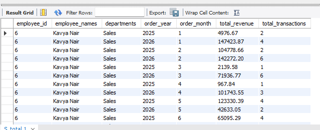
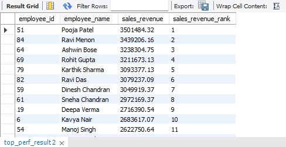
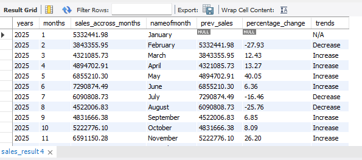
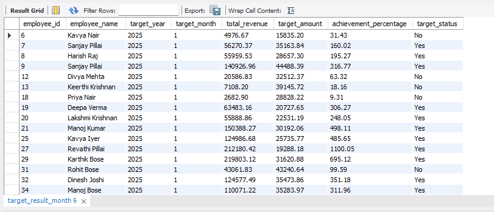

# Sales Analytics and Employee Performance System

A MySQL project that analyses sales performance and employee results using a relational database with constraints and about 4,000+ orders.

## Database
Database name: `sales_analytics` (MySQL 8.0)

| Table | What it stores |
|---|---|
| departments | Company departments and locations |
| employees | Employee details, department, manager, salary, region |
| customers | Customer details, city, segment |
| products | Product catalogue with price, cost and stock |
| orders | Each sale: customer, sales rep, date, status, discount |
| order_items | Products and quantities inside each order |
| sales_targets | Monthly sales target for each sales rep |
| performance_reviews | Quarterly rating and KPI score for each employee |

**Constraints used:** primary keys, foreign keys (with ON DELETE / ON UPDATE rules), UNIQUE, CHECK, NOT NULL, ENUM and DEFAULT values.

## ER Diagram
[View ER Diagram](images/sales_analytic_er.pdf)

## How to run
1. Run `schema.sql` to create the database and tables.
2. Run `data_insert.sql` to load the data (about 4,000 orders and 5,000 order items).
3. Run `sales_analytics_project.sql` to see the analysis.

## Analysis
| Phase | Question | Concepts |
|---|---|---|
| 1 | Total transactions and revenue per employee, department and month | Joins, GROUP BY, COUNT DISTINCT, View |
| 2 | Which employees are the top performers by revenue? | CTE, RANK() window function, View |
| 3 | How does each month's sales compare with the previous month (increase or decrease)? | CTEs, LAG(), NULLIF, CASE |
| 4 | Did each employee reach their sales target? (Yes / No) | Multiple CTEs, LEFT JOIN, COALESCE, CASE |

Revenue is calculated as `quantity * unit_price * (1 - discount_pct / 100)` and counts only `Shipped` and `Delivered` orders.

## Key findings
- Top employee: _(add name and revenue)_
- Best month for sales: _(add month)_
- Employees who reached their target: _(add count)_

## Skills demonstrated
Database design, constraints, joins, subqueries, CTEs, window functions (RANK, LAG), views, data validation.

### Sales by employee, department and month

### Top performing employees

### Month-over-month sales growth

### Target vs actual

